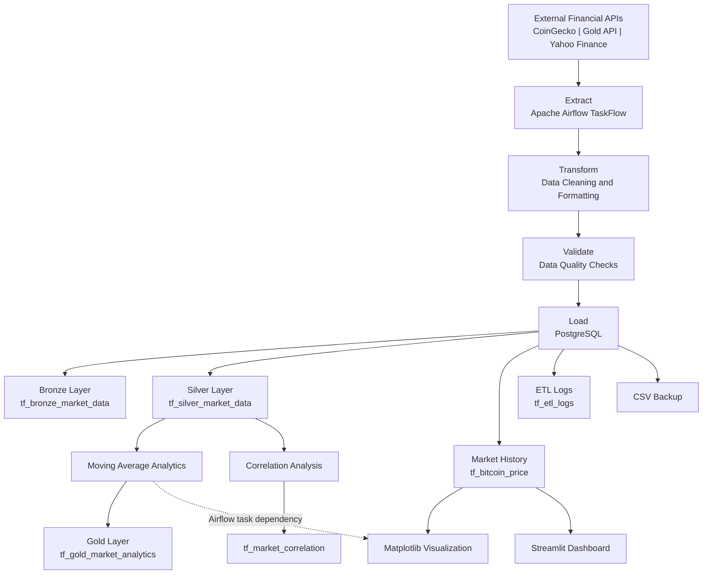
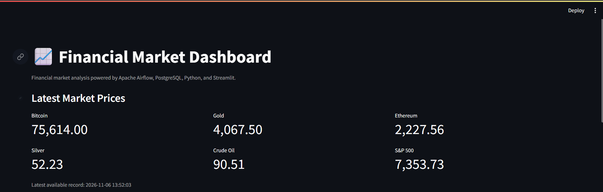
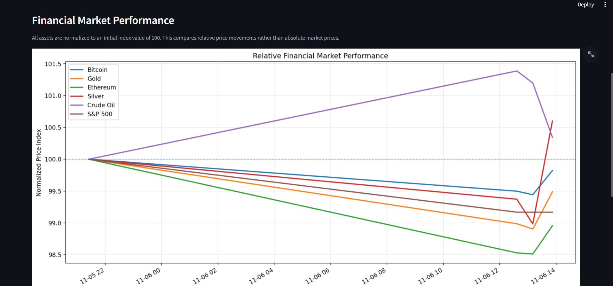
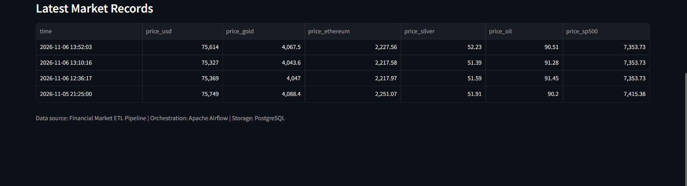

# Financial Market ETL Pipeline with Apache Airflow

## Overview

An end-to-end Data Engineering project that automates the ingestion, transformation, validation, storage, and analysis of financial market data using **Python, Apache Airflow, PostgreSQL, and Pandas**.

The pipeline collects market price data for six financial assets:

- Bitcoin
- Ethereum
- Gold
- Silver
- Crude Oil
- S&P 500

It implements a **Medallion Architecture-inspired design**, organizing financial market data into Bronze, Silver, and Gold layers.

Apache Airflow orchestrates the complete ETL workflow, including API ingestion, data transformation, quality validation, PostgreSQL loading, analytical processing, CSV backups, and visualization generation.

The project also includes an interactive Streamlit dashboard for exploring financial market prices and comparing relative asset performance.

---

## Key Features

- **Multi-Source Data Ingestion:** Fetches financial market data from CoinGecko, Gold API, and Yahoo Finance.
- **Workflow Orchestration:** Automates ETL workflows using Apache Airflow 3 TaskFlow API.
- **Medallion Architecture:** Organizes data into Bronze, Silver, and Gold processing layers.
- **Data Transformation:** Converts extracted market prices into structured datasets using Python.
- **Data Quality Validation:** Performs NULL, numeric, positive-value, and finite-value checks.
- **PostgreSQL Data Warehouse:** Stores market data, ingestion records, execution logs, and analytical results.
- **Automated Error Handling:** Implements task retries and failure logging.
- **CSV Backups:** Generates timestamped CSV backups of processed market data.
- **Moving Average Analytics:** Calculates 7-observation and 30-observation moving averages.
- **Correlation Analysis:** Calculates Pearson correlation between Bitcoin and Gold prices.
- **Data Visualization:** Generates normalized financial market performance charts using Matplotlib.
- **Interactive Dashboard:** Displays market price metrics, performance comparisons, and recent records using Streamlit.
- **Dockerized Deployment:** Uses Docker Compose to manage Apache Airflow and PostgreSQL.
- **Environment-Based Configuration:** Uses environment variables for database connectivity and application settings.

---

## Tech Stack

| Technology | Purpose |
|---|---|
| Python | ETL development and data processing |
| Apache Airflow 3.2.1 | Workflow orchestration |
| PostgreSQL 16 | Data warehouse and data storage |
| Pandas | Data transformation and analytics |
| Matplotlib | Financial market visualization |
| Streamlit | Interactive dashboard |
| Docker | Containerization |
| Docker Compose | Multi-container management |
| psycopg2 | PostgreSQL connectivity |
| Requests | REST API integration |
| yFinance | Yahoo Finance market data |
| CoinGecko API | Bitcoin and Ethereum price data |
| Gold API | Gold and Silver price data |

---

## System Architecture

The pipeline follows a Medallion Architecture-inspired approach consisting of three processing layers.

### 1. Bronze Layer – Ingestion Data

Stores JSONB snapshots of the ingested ETL payload in PostgreSQL.

**Table:**

- `tf_bronze_market_data`

### 2. Silver Layer – Processed Data

Stores cleaned, transformed, and validated financial market records.

**Tables:**

- `tf_silver_market_data`
- `tf_bitcoin_price`

`tf_bitcoin_price` maintains the historical price records for all six financial assets.

### 3. Gold Layer – Analytical Data

Stores calculated analytical datasets and financial market metrics.

**Tables:**

- `tf_gold_market_analytics`
- `tf_market_correlation`

The Gold analytics table contains calculated moving averages, while the correlation table stores Bitcoin-Gold correlation results.

**Additional operational table:**

- `tf_etl_logs` – Maintains ETL execution status and record counts.

---

## Architecture Diagram



*The diagram represents the logical data flow and database interactions. Actual task dependencies are defined in the Airflow DAG.*

---

## Airflow DAG Workflow

The project uses Apache Airflow's TaskFlow API to orchestrate the complete ETL pipeline.

**DAG ID:** `new_tf_etl_pipeline`

**Schedule:** Daily (`@daily`)

**Catchup:** Disabled

**Retries:** 2 attempts with a 1-minute retry delay.

### Workflow Execution

```text
                    extract
                       |
                       v
                    transform
                       |
                       v
                    validate
                       |
                       v
                      load
                       |
           +-----------+-----------+
           |           |           |
           v           v           v
       backup_csv  moving_avg  correlation_analysis
                       |
                       v
                      plot
```

### DAG Tasks

| Task | Description |
|---|---|
| Extract | Retrieves financial market data from external APIs. |
| Transform | Converts extracted prices into structured records. |
| Validate | Performs data quality checks before loading. |
| Load | Inserts records into PostgreSQL Bronze, Silver, market history, and ETL logging tables. |
| Backup | Generates timestamped CSV backups. |
| Calculate Moving Averages | Calculates 7-observation and 30-observation moving averages. |
| Correlation Analysis | Calculates Bitcoin-Gold Pearson correlation. |
| Plot | Generates normalized financial market performance visualizations. |

The DAG also includes a failure callback for logging task and DAG failure details. Optional email notifications can be configured through Airflow SMTP settings.

---

## Project Structure

```text
financial-market-etl/
│
├── dags/
│   ├── .airflowignore
│   ├── taskflow_etl_pipeline.py
│   │
│   ├── tasks/
│   │   ├── __init__.py
│   │   ├── extract.py
│   │   ├── transform.py
│   │   ├── validate.py
│   │   ├── load.py
│   │   ├── backup.py
│   │   ├── analytics.py
│   │   ├── correlation.py
│   │   ├── plot.py
│   │   ├── db_connection.py
│   │   └── failure_alert.py
│   │
│   ├── backup/              # Generated CSV backups
│   └── plots/               # Generated visualizations
│
├── dashboard/
│   └── TaskFlow_app.py
│
├── logs/                    # Runtime-generated Airflow logs
│
├── docker-compose.yaml
├── requirements.txt
├── .env.example
├── .gitignore
└── README.md
```

**Note:** The `backup/`, `plots/`, and `logs/` directories are used for runtime-generated files. Generated backups, visualizations, and logs are excluded from GitHub through `.gitignore`.

---

## Setup and Installation

### Prerequisites

Make sure the following software is installed:

- Python 3
- Docker Desktop
- Docker Compose
- Git

An active internet connection is required to retrieve financial market data from external APIs.

### 1. Clone the Repository

```bash
git clone https://github.com/<your-github-username>/financial-market-etl.git
```

Navigate to the project directory:

```bash
cd financial-market-etl
```

### 2. Configure Environment Variables

Create your local `.env` file using the provided example:

```bash
cp .env.example .env
```

Open `.env` and configure the required variables:

```env
# Airflow
AIRFLOW_UID=50000

# PostgreSQL
POSTGRES_HOST=postgres
POSTGRES_EXTERNAL_HOST=localhost
POSTGRES_DB=airflow
POSTGRES_USER=airflow
POSTGRES_PASSWORD=change_me
POSTGRES_PORT=5433

# Notifications
ALERT_EMAIL=

# Optional SMTP configuration
SMTP_HOST=smtp.gmail.com
SMTP_USER=
SMTP_PASSWORD=
SMTP_PORT=587
SMTP_MAIL_FROM=
```

Replace the example database password with a secure password of your own.

**Important:**

- `POSTGRES_HOST=postgres` is used by Airflow containers to connect to PostgreSQL internally.
- `POSTGRES_EXTERNAL_HOST=localhost` is used by the Streamlit dashboard running on your local machine.
- `POSTGRES_PORT=5433` maps the local machine's PostgreSQL port to the container's internal port `5432`.
- SMTP variables are optional and should be configured only when email notifications are required.

Never commit `.env` or expose database passwords and SMTP credentials on GitHub.

### 3. Install Python Dependencies

Create a Python virtual environment:

```bash
python -m venv venv
```

Activate the environment in Git Bash:

```bash
source venv/Scripts/activate
```

Install dependencies:

```bash
pip install -r requirements.txt
```

### 4. Start Docker Containers

Start Apache Airflow and PostgreSQL:

```bash
docker compose up -d
```

Check container status:

```bash
docker compose ps
```

View service logs:

```bash
docker compose logs -f
```

### 5. Access Apache Airflow

Open the Airflow web interface:

**URL:** http://localhost:8080

The project runs Airflow in standalone mode. Use the administrator credentials generated or configured during the initial Airflow startup. Check the Airflow container logs for the initial credentials when needed.

After logging in:

1. Open the DAGs page.
2. Locate `new_tf_etl_pipeline`.
3. Trigger the DAG manually or allow its daily schedule to execute.
4. Monitor individual task execution and logs.

### 6. Access PostgreSQL

Connect to the PostgreSQL container:

```bash
docker compose exec postgres psql -U airflow -d airflow
```

List available tables:

```sql
\dt
```

Example query to retrieve market price records:

```sql
SELECT *
FROM tf_bitcoin_price
ORDER BY time DESC;
```

Retrieve Gold analytics:

```sql
SELECT *
FROM tf_gold_market_analytics
ORDER BY time DESC;
```

Retrieve correlation results:

```sql
SELECT *
FROM tf_market_correlation
ORDER BY run_time DESC;
```

Exit PostgreSQL:

```sql
\q
```

If you change the database username or name in `.env`, use those values in the connection command.

### 7. Run the Streamlit Dashboard

Make sure Docker containers are running and PostgreSQL is accessible.

From the project root, activate your Python virtual environment and execute:

```bash
streamlit run dashboard/TaskFlow_app.py --server.port 8502
```

Open the dashboard:

**URL:** http://localhost:8502

The dashboard displays:

- Latest prices for Bitcoin, Ethereum, Gold, Silver, Crude Oil, and S&P 500.
- Normalized financial market performance comparisons.
- Recent financial market records.

Dashboard data is cached for 60 seconds.

### 8. Stop Docker Containers

To stop the services:

```bash
docker compose down
```

This stops and removes the containers but preserves named PostgreSQL volumes.

**Warning:** Avoid running the following command unless you intentionally want to delete persistent PostgreSQL data:

```bash
docker compose down -v
```

---

## Database Schema

The pipeline uses PostgreSQL to store market ingestion records, transformed datasets, execution logs, and analytical results.

| Table Name | Layer / Purpose | Description |
|---|---|---|
| `tf_bronze_market_data` | Bronze | Stores JSONB ingestion payloads. |
| `tf_silver_market_data` | Silver | Stores cleaned financial market records. |
| `tf_bitcoin_price` | Market History | Maintains historical prices for all six assets. |
| `tf_etl_logs` | Operational | Stores ETL execution status and record counts. |
| `tf_gold_market_analytics` | Gold | Stores moving average analytics. |
| `tf_market_correlation` | Analytics | Stores Bitcoin-Gold correlation results. |

### Example SQL Queries

Retrieve the latest financial market records:

```sql
SELECT *
FROM tf_bitcoin_price
ORDER BY time DESC
LIMIT 10;
```

Retrieve moving average analytics:

```sql
SELECT
    time,
    bitcoin_price,
    btc_ma_7,
    btc_ma_30,
    gold_price,
    gold_ma_7,
    gold_ma_30
FROM tf_gold_market_analytics
ORDER BY time DESC;
```

Retrieve ETL execution history:

```sql
SELECT *
FROM tf_etl_logs
ORDER BY run_time DESC
LIMIT 10;
```

---

## Financial Market Analytics

### 1. Moving Average Analysis

The pipeline calculates:

- **7-Observation Moving Average:** Helps identify short-term price trends.
- **30-Observation Moving Average:** Helps analyze longer-term price movements.

These calculations use rolling observation windows. With one successful record per day, they correspond to approximately 7-day and 30-day moving averages.

### 2. Correlation Analysis

The pipeline calculates the Pearson correlation coefficient between Bitcoin and Gold prices.

This analysis helps examine the historical linear relationship between the two assets.

Correlation measures association and does not establish causation.

### 3. Multi-Asset Performance Analysis

The pipeline processes six financial assets:

- Bitcoin
- Ethereum
- Gold
- Silver
- Crude Oil
- S&P 500

These assets are compared using a normalized price index, with the first valid observation in the selected dataset set to 100.

This makes relative price movements easier to compare across assets with different price scales.

---

## Data Visualization

The pipeline generates financial market visualizations using Matplotlib.

Generated output:

```text
dags/
└── plots/
    └── gold_vs_bitcoin_etl.png
```

Each asset is normalized against its first valid observation to compare relative performance over time.

The Streamlit dashboard provides an interactive interface for viewing the latest market prices and normalized performance chart.

## Dashboard Preview





---

## Configuration and Security

The project uses environment variables to manage database and application configuration.

- `.env` contains local credentials and environment-specific settings.
- `.env.example` documents the required configuration variables.
- `.gitignore` excludes credentials, generated files, logs, and local development artifacts.

For security, never publish real passwords, SMTP credentials, or other sensitive configuration values.

---

## Future Enhancements

- Apache Kafka for real-time streaming ingestion.
- Redis for caching frequently accessed market data.
- Great Expectations for advanced data quality validation.
- dbt for modular SQL transformations and analytics.
- Power BI / Tableau for advanced business intelligence dashboards.
- AWS deployment for cloud-based data engineering infrastructure.
- Airflow sensors and SLA monitoring for improved workflow reliability.

---

## Author

**Abhishek Wafare**

Data Engineering | Python | SQL | Apache Airflow | PySpark | Kafka | PostgreSQL